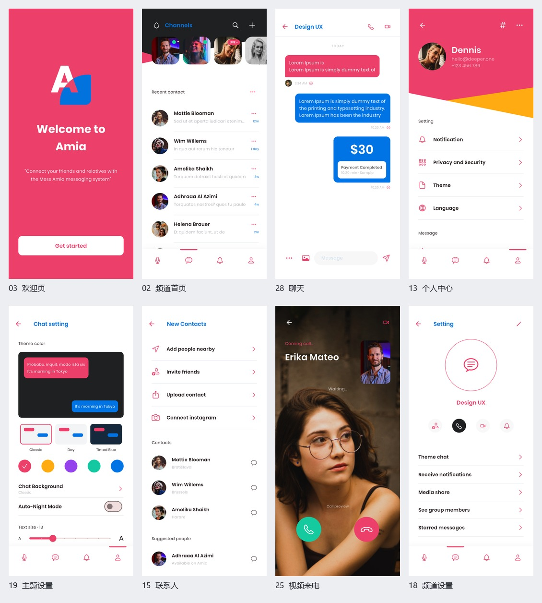

# Amia Messaging

基于 Pixso「Amia - Messaging App UI Kit」的 Flutter 应用，提供登录、频道、聊天、联系人、通话演示、个人资料及设置。

- [项目说明与架构](docs/项目说明.md)
- [完整界面截图](docs/界面截图.md)
- [验证记录](docs/验证记录.md)
- [Android 演示安装包](dist/Amia-demo.apk)



## 快速运行

```powershell
flutter pub get
flutter run
```

演示登录：格式正确的邮箱 + 至少 6 位密码。注册验证码：**1234**。

消息、资料和偏好保存在本机。认证、音视频、推送、相机和地图目前为 UI 演示，详细范围见项目说明。

```powershell
flutter analyze
flutter test --concurrency=1
flutter drive --driver=test_driver/screenshots.dart --target=integration_test/app_test.dart -d <模拟器ID>
```
