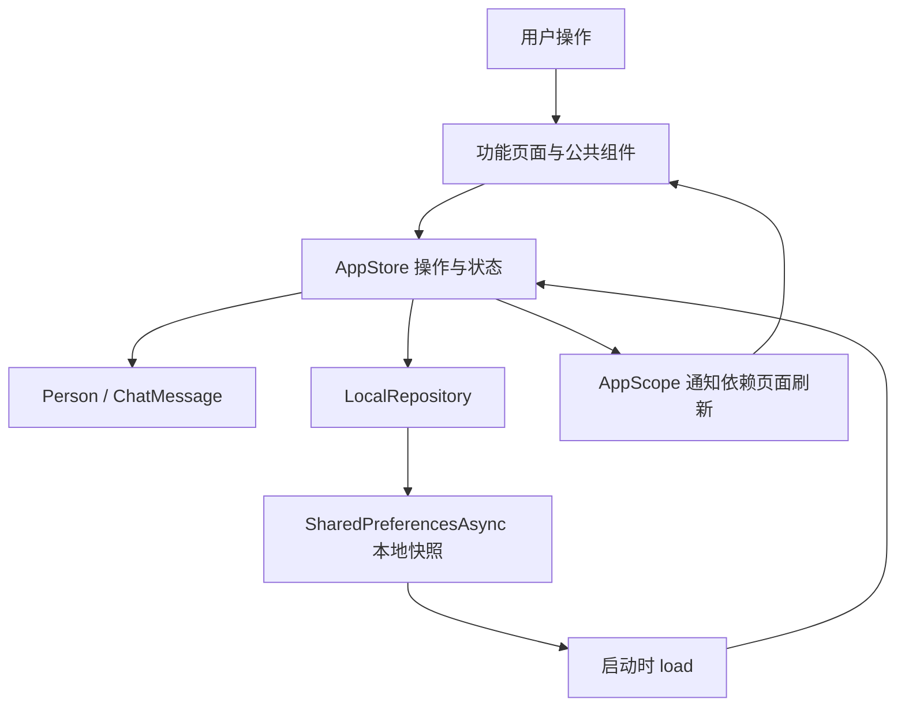

# Amia Messaging · Flutter 项目说明

基于 Pixso「Amia - Messaging App UI Kit」的 Flutter 移动应用。读取 Design 页面全部 30 个画板，复用原稿中的品牌标志、头像、插画及照片，保留 Poppins 字体、玫红/蓝色配色、斜切页头、故事卡片与底部导航。

这是可以运行、操作并在设备本地保存数据的 UI 演示项目。Android 与 Web 工程均已提供。真实即时通信服务、身份认证和音视频服务尚未接入。

## 1. 主要界面

以下图片来自 Android 模拟器内运行的 Flutter 应用。完整截图索引见 [界面截图](界面截图.md)。Pixso 原稿导出文件独立保存在 [design](design/) 中。

### 欢迎与登录

 

### 频道与聊天

 

### 个人资料与主题

 

### 通话与联系人

 

## 2. 运行方式

环境：Flutter 3.47.7、Dart 3.13.5。推荐使用与此版本兼容的 Flutter stable SDK，安装 Android SDK 与 JDK 17。

```powershell
flutter pub get
flutter devices
flutter run -d <Android设备ID>
```

Web 预览：

```powershell
flutter run -d chrome
```

演示登录填写格式正确的邮箱和至少 6 位密码即可进入首页；不会调用远程认证，也不会保存密码。注册流程中的演示验证码是 **1234**。点击「Start with Google」进入本地示例账号选择页。

建议体验路线：欢迎 → 登录 → 频道 → 点击联系人进入聊天 → 发送消息 → 长按消息收藏 → 点击聊天标题进入频道设置；再通过底部个人中心查看资料、主题与语言偏好。

## 3. 项目结构

```text
AmiaMessaging/
├── lib/
│   ├── main.dart                  # 初始化平台、本地存储和应用
│   ├── app.dart                   # MaterialApp、主题绑定及统一命名路由
│   ├── core/
│   │   ├── app_store.dart         # 共享状态、操作方法、存储队列与 AppScope
│   │   ├── theme.dart             # 颜色、字体、表单与主题规范
│   │   └── widgets.dart           # 按钮、头像、列表行、导航和自适应表单
│   ├── data/
│   │   ├── models.dart            # 联系人、消息模型与示例数据
│   │   └── local_repository.dart  # 版本化 JSON 快照、本地持久化
│   └── features/
│       ├── auth/auth_screens.dart       # 登录、注册、验证码、资料、二维码、地址
│       ├── messaging/messaging_screens.dart # 频道、聊天、消息菜单、收藏和创建频道
│       ├── people/people_screens.dart   # 联系人、邀请、附近的人和成员列表
│       ├── calls/call_screens.dart     # 通话列表、来电/通话演示、照片预览
│       └── settings/settings_screens.dart # 个人中心、主题、语言、通知和隐私
├── assets/images/                # 从 Pixso 导出的可复用素材
├── Font/                         # 用户提供的 Poppins 字体；应用引用其中 4 个字重
├── android/                      # Android 工程与 Amia 图标
├── web/                          # Web 入口与应用图标
├── test/                         # 状态、持久化和界面测试
├── integration_test/app_test.dart # Android 操作流程与截图采集
├── test_driver/screenshots.dart  # 保存模拟器 PNG 截图
├── docs/
│   ├── 项目说明.md               # 本文档
│   ├── 界面截图.md               # 全部页面与状态的截图索引
│   ├── 验证记录.md               # 环境、检查命令和验证结果
│   ├── design/                   # 30 张 Pixso 原稿
│   └── screenshots/              # 实际应用截图
└── pubspec.yaml / pubspec.lock    # 依赖、字体和资源配置
```

## 4. 架构与数据流

采用按功能组织的轻量分层结构。页面负责展示和输入，`AppStore` 负责共享状态及业务操作，`LocalRepository` 负责设备存储。局部表单和弹层使用 `StatefulWidget`，跨页面数据使用 Flutter 原生 `ChangeNotifier` 与 `InheritedNotifier`。



以发送消息为例：输入框校验非空 → `AppStore.send(chatId, text)` → 消息写入指定会话 → 通知界面刷新 → 串行保存 JSON 快照。启动时读取快照恢复消息、资料和偏好。会话按 ID 隔离，归档、未读、静音和收藏状态随快照保存。

持久化键为 `amia.snapshot.v1`。支持保存登录演示状态、姓名、邮箱、手机号、头像、生日、性别、地址、主题、字体大小、语言偏好、通知开关、频道列表、会话与消息状态。密码不进入模型或存储。

## 5. 页面与功能范围

| 模块 | 可以操作的内容 |
|---|---|
| 账号 | 邮箱/密码表单校验、示例账号选择、注册验证码、资料编辑、头像选择、二维码展示、地址输入、退出 |
| 频道 | 标准/展开两种布局、搜索、创建频道、归档/恢复、标记未读、静音 |
| 聊天 | 发送文字、发送内置图片、复制、编辑、删除、转发、收藏、支付样式卡片 |
| 联系人 | 示例联系人、成员列表、邀请表单校验、示例附近的人、联系人入口 |
| 设置 | 主题色、深色模式、聊天文字大小、语言偏好、通知偏好、共享媒体 |
| 通话 | 来电接听/拒绝、通话计时、静音/扬声器/摄像头按钮状态、结束 |
| 照片 | 内置照片、预览滤镜、图片预览、添加到本地聊天 |

需要后端或原生服务才能投入生产的部分：

- 登录、注册、密码重置和 Google 账号选择目前为本地流程；没有远程账号创建或邮件发送。
- 联系人、附近的人、通话记录和通知列表使用示例数据；没有读取系统通讯录、位置或推送服务。
- 音视频页展示静态照片及交互状态；没有建立真实通话，也不访问麦克风或摄像头。
- 相机页使用原稿照片；不会打开设备相机或系统相册。地址页使用静态地图，不执行地理编码。
- 邀请只生成当前页面的待邀请记录，没有向任何人发送消息。二维码包含联系标识，未实现扫描入口。
- 语言页保存语言偏好，页面文案沿用设计稿英文；尚未配置完整国际化翻译。
- 支付卡片是消息样式示例，无支付能力。通知与静音开关是本地偏好。

## 6. 设计适配

| 项目 | 处理方式 |
|---|---|
| 字体 | Poppins Regular / Medium / SemiBold / Bold，离线加载 |
| 主色 | 玫红 `#EC3F6A`、蓝色 `#0074E4`、深色 `#1F2021`、黄色 `#FFAB11` |
| 间距 | 主要页面左右 28，联系人头像 48，主要按钮高 56 |
| 插画/照片 | 从设计节点单独导出，不以整张设计图覆盖交互界面 |
| 顶部/底部 | 使用 Android 系统状态栏、导航栏与 SafeArea，未绘制假的 iOS 系统栏 |
| 屏幕 | 表单可滚动，聊天输入框随键盘调整；Web 内容最大宽度 480 |
| 交互状态 | 原稿中的菜单、键盘和弹窗转化为实际控件；系统键盘由设备呈现 |

原稿中部分占位文案、拼写错误做了可读性修正。菜单使用 Flutter 原生弹层，图标采用 Cupertino 图标库；位置与形状存在平台适配差异。

## 7. 验证与截图复现

```powershell
flutter analyze
flutter test --concurrency=1
flutter drive --driver=test_driver/screenshots.dart --target=integration_test/app_test.dart -d <模拟器ID>
flutter build apk --release
flutter build web --release
```

截图测试使用独立内存状态，避免修改正常运行应用的演示数据。每次截图前等待页面稳定并检查 Flutter 异常；截图驱动将 PNG 写入 `docs/screenshots/`。

重新生成文档内的截图总览和索引可运行 `python tool/build_gallery.py`，该辅助脚本需要 Pillow。原始应用截图无需此依赖即可查看。

测试不仅访问页面，也执行登录、无效/有效验证码校验、创建频道、发送和收藏消息、语言选择、深色主题、接听和静音、归档恢复等操作。单元测试另外验证会话隔离和数据重新加载。

最终验证结果及安装包位置见 [验证记录](验证记录.md)。

## 8. 后续扩展位置

真实服务接入可从 `LocalRepository` 与 `AppStore` 的边界扩展：添加 API/WebSocket 仓库、认证服务、媒体上传与消息订阅。音视频、地图、相机分别替换对应功能页的数据入口即可。若业务规模扩大，可按页面继续拆分 `*_screens.dart`，无需预先增加路由框架或状态管理框架。

依赖说明：[shared_preferences 官方包文档](https://pub.dev/packages/shared_preferences)、[qr_flutter 包文档](https://pub.dev/packages/qr_flutter)。前者用于演示偏好和少量消息存储，后者生成离线二维码。生产环境聊天历史应迁移到数据库，凭据应使用专门的安全存储。
